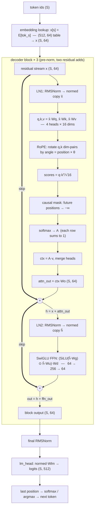
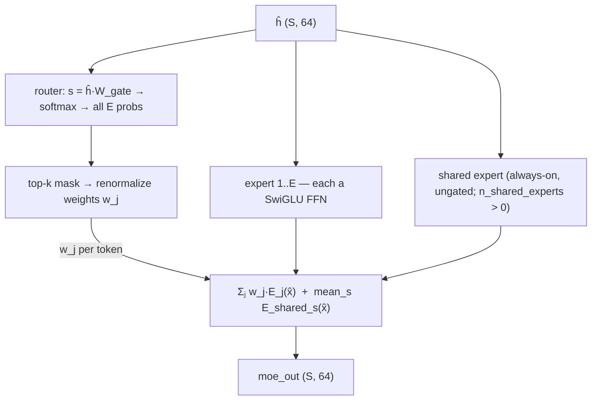
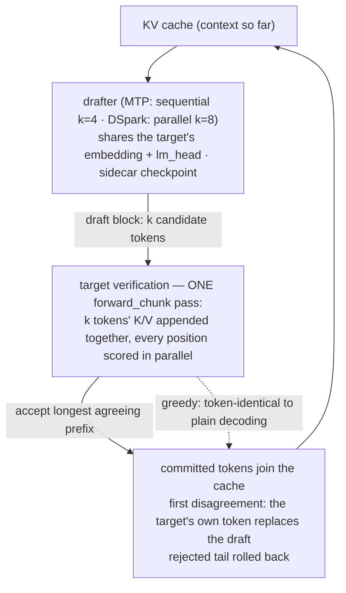

# AI Transformer Demo (Four-Backend)

A pedagogical implementation of a decoder-only transformer with **four
equivalent backends**: NumPy (pure manual math, the teaching reference),
PyTorch (the production idiom), Triton (GPU kernels over a PyTorch model),
and CUDA (bare-metal NVRTC kernels). All four tracks share the same
architecture, the same key scheme, and the same config — a model trained on
one track loads and runs on any other. The architecture covers the modern
production surface: RoPE, GQA, SwiGLU, opt-in Mixture-of-Experts (with
always-on shared experts), an exact KV cache, and **speculative decoding**
(MTP + DSpark drafters, ADR 0003). A **learning mode** adds an interactive
web page (any of the four backends, selected in-page) that visualizes the
architecture — including the drafter and its verification lane — shows
every intermediate tensor of an inference, and exports full inference
records.

## What each track teaches

Each track answers a different question about the *same* model:

| Track | Question it answers | Read it for |
| --- | --- | --- |
| **NumPy** (`impl/_np/`) | *How does the math work?* | Hand-derived forward + analytic backward, formula citations, shape comments on every matrix op. The teaching reference. |
| **PyTorch** (`impl/_torch/`) | *How do you implement it properly with a framework?* | Production idiom: `nn.Module` composition, autograd, `F.scaled_dot_product_attention`, `torch.optim`. |
| **Triton** (`impl/_triton/`) | *How do you write the kernels?* | Memory-traffic-aware GPU kernels (online softmax / FlashAttention) over a PyTorch skeleton. |
| **CUDA** (`impl/_cuda/`) | *What does the metal see?* | Bare-metal NVRTC kernels, explicit launches, no framework. |

Because all four implement bit-comparable behavior on one checkpoint format,
you can trace the same tensor through four increasingly low-level lenses.

## Where to read what

| Question | One owner |
| --- | --- |
| What does *GQA / RoPE / SwiGLU / KV cache* mean? | [CONTEXT.md](CONTEXT.md) — the domain glossary + shape notation |
| How does the forward pass work, equation by equation? | [docs/math/transformer-walkthrough.md](docs/math/transformer-walkthrough.md) |
| How were the demo checkpoints trained (pre-train → SFT → tool)? | [docs/math/training-pipeline.md](docs/math/training-pipeline.md) |
| Why these design decisions? Which are irreversible? | [docs/architecture/design.md](docs/architecture/design.md) + the [ADRs](docs/architecture/adr/) |
| What is the Triton→PyTorch seam? | [docs/architecture/seam_triton_to_torch.md](docs/architecture/seam_triton_to_torch.md) |
| What docstring style does the code follow? | [docs/reference/docstring_style.md](docs/reference/docstring_style.md) |
| How do I develop here (rules, tooling, tests)? | [AGENTS.md](AGENTS.md) |

Finished task specs are deleted — the git history is the record.
`uv run python -m scripts.check_docs` verifies the docs against the code
(referenced paths exist, claimed counts match the source).

## The learning-mode example model

`scripts/learning.py` serves the **`learning_moe_rl` checkpoint by
default** — and all four page variants are REAL end-to-end language
models: a **BPE-512 tokenizer** (with the thinking-section specials
`<|think|>` / `<|answer|>`) trained on the actual mixed corpus (so text
splits into sub-word tokens like `Ġonce`, ` the`, `fu`, not single ASCII
letters), trained by
[`scripts/train_demo_model_v3.py`](scripts/train_demo_model_v3.py) in
five stages — pre-train on TinyStories → code SFT → tool-call SFT →
**thinking SFT** (reasoning distillation: GSM8K gold rationales +
synthetic arithmetic, each row `question <|think|> rationale
<|answer|> number`) → **GRPO RL** (reward = 1.0·correctness +
0.2·format, group-relative advantage, KL to the frozen SFT model) —
then the drafter sidecars are re-distilled from the RL target (ADR
0003). Two families, four variants:

- **dense** (`learning_think`) — 6 layers, thin SwiGLU FFN (dim 96),
  275,264 params — the DEPTH twin (the Qwen3-32B shape), SFT-final.
- **moe** (`learning_moe_think`) — the param-matched MoE of ADR 0005:
  3 layers, E=8 routed + 1 always-on shared expert at `expert_dim=32`,
  top-1 — 282,560 total (1.03× dense) but only 153,536 active per token
  (~54%), SFT-final.
- **dense-rl** (`learning_rl`) / **moe-rl** (`learning_moe_rl`, the
  default) — the same two models after the GRPO RL stage.

Same tokenizer, same corpus, same seed per family — so BOTH page
comparisons are controlled: `moe-rl` vs `dense-rl` isolates the FFN
geometry at the final level; `*-rl` vs `*` isolates RL's delta (the RL
run started from exactly the shown SFT checkpoint). Below is the shared
**tokenizer + architecture** card (the `n_experts` row is what the
variant dropdown switches).

| Hyperparameter | Value | Choice & why |
| --- | --- | --- |
| `vocab_size` | 512 | Byte-level BPE, case preserved, with 10 special tokens (`<|tool_call|>`, `<|think|>`, `<|answer|>`, …) so SFT can teach chat/tool/reasoning shapes. Small enough that the full softmax fits on screen. |
| `context_length` | 128 | Sequences are truncated/padded to 128; every (S, …) tensor in the record has ≤129 rows — inspectable by eye. |
| `embed_dim` D | 64 | Model width. Small enough that every attention score, expert weight, and residual value can be printed in full. |
| `n_layers` L | 3 | Three repeated decoder blocks — deep enough to show how the residual stream accumulates, shallow enough to follow end to end. |
| `n_heads` H | 4 (`n_groups=4`) | Head dim = 16. `n_groups == n_heads` → every head has its own K/V (plain MHA); set `n_groups < n_heads` in config and the same code runs GQA. |
| `rope_dim` | 0 | 0 rotates the full head dim (standard RoPE); no learned position embedding anywhere. |
| FFN / `n_experts` | dense: SwiGLU `expert_dim=96` (= 1.5·D) / moe: E=8 routed + 1 always-on shared at `expert_dim=32`, top-1 | The FFN slot — where the two families diverge (ADR 0005). Totals match: dense 275,264 all-active vs moe 282,560 (1.03×) with only 153,536 active/token (~54%) — the total-vs-active trade at toy scale. |
| biases / weight tying | none | LLaMA convention: RMSNorm has only γ, all projections are bias-free, `lm_head` is its own matrix (not the tied embedding). |

### Architecture diagrams

**The forward pass (the default dense model).**



Thick `==>` edges are the residual stream's skip connections; the two norms
read *copies* (`x̂`, `ĥ`) — the stream itself is never normalized. At
generation time each block additionally keeps a K/V cache (prefill writes the
whole prompt, each decode appends one row), but the math above is unchanged —
see `NumPyModel.make_cache` / `forward_prefill` / `forward_step` in
`impl/_np/model.py`.

**The MoE block (opt-in, `n_experts > 1`)** replaces each block's dense
SwiGLU FFN — everything else in the diagram above is unchanged. The router
picks the top-k experts per token; a shared expert (ADR 0002) always runs:



**The speculative-decoding round (ADR 0003)** wraps generation: a small
drafter proposes k tokens; the target model above verifies them all in ONE
parallel pass (`forward_chunk`); the longest agreeing prefix commits:



A bad drafter only costs speed, never correctness — that is the lossless
contract, pinned by the verify_equivalence scenarios.

The **per-component math and intuition** (embedding → RMSNorm → attention →
RoPE → residuals → SwiGLU → MoE → speculative decoding → lm_head, each with
the equation, the *why*, and the code anchor) lives in one place:
[docs/math/transformer-walkthrough.md](docs/math/transformer-walkthrough.md)
(§1–§9). Shape letters (B, S, D, H, G, hd, V, E, FF) are defined once in
[CONTEXT.md](CONTEXT.md) → "Shape notation".

## Features

- **Four backends, one model**: NumPy (analytic backward, the math
  reference), PyTorch (autograd + `F.scaled_dot_product_attention` +
  `torch.optim`), Triton (FlashAttention-style online-softmax kernel), CUDA
  (NVRTC kernels for RMSNorm, RoPE, attention, FFN).
- **Standard architecture**: pre-norm LLaMA block
  (`h = x + attn(ln1(x)); out = h + mlp(ln2(h))`), RMSNorm, GQA, RoPE,
  SwiGLU (dense by default; MoE is opt-in), causal mask, no weight tying, no
  biases.
- **KV cache**: the per-token step path is exact (`forward_prefill` +
  `forward_step` == full re-forward). The generators step one token per
  iteration (O(1) per step). TurboQuant (1-bit quantized cache) is wired as
  an alternative with a parity-budget test.
- **Speculative decoding** (ADR 0003): all four tracks expose
  `forward_chunk` — k tokens of K/V appended in one pass (the target's
  verification step). The drafter protocol (`shared/draft.py`) has two
  live implementations: **MTP** (one block, sequential, k=4, shares the
  target's embedding + lm_head) and **DSpark** (semi-AR parallel backbone +
  causal refinement, k=8, plus confidence-scheduled verification with a
  0.8 prefix-survival target). Drafters are distilled from the frozen
  target (`scripts/train_drafters.py`) and live as sidecar checkpoints
  (`<model>/draft_{mtp,dspark}/`). The greedy path is **token-identical to
  plain greedy** — the lossless contract, pinned by verify_equivalence
  scenarios; NumPy also carries the rejection-sampling theorem for
  temperature mode.
- **Analytic backward** (NumPy): every operator has a closed-form
  `backward(dout, x) -> (dinput, dparams)`; `check_model_gradients` verifies
  it against finite differences (float64, ~1e-10, MoE top-k kink-aware).
- **Cross-backend parity**: three-tier tolerance policy (see AGENTS.md rule
  2); the cross-backend suite covers dense/GQA/MoE parity, speculative
  decoding (chunk parity, spec-greedy ≡ plain-greedy, sidecar round-trip
  across tracks), GPU parity, and a 3-way equivalence demo;
  `scripts.verify_equivalence` runs 9 end-to-end scenarios (incl.
  `spec_mtp_np_torch` / `spec_dspark_np_torch`).
- **Checkpoint interchange**: one flat-dict key scheme
  (`shared.constants.Keys`, HF-Llama naming) + a parameter registry
  (`shared/registry.py`) that validates shape and key-set on load
  (stale checkpoints fail fast). Every track builds its model by
  **constructor injection threaded down the chain** —
  `Model.from_checkpoint(dir)` (or `Model(config, params)`) validates the
  checkpoint, then the stack/block/operator constructors each receive their
  slice, so a served model is born with learned weights and no operator is
  built with defaults and patched later; `Model(config)` is the fresh
  training start (RMSNorm gammas = ones). Injection always copies in place
  (never reassigns storage).
- **Learning mode** (all four backends): `scripts/learning.py` hosts a web
  page (stdlib HTTP server, no dependencies) with prompt + generation, an
  architecture diagram with flow navigation (click a node to light up its
  predecessors/successors) and per-block numbers, and downloadable JSON
  inference records of every intermediate tensor. The page runs records on
  all four backends via an in-page dropdown; the CLI `--backend numpy|torch`
  only picks the track the startup load materializes. All record adapters
  emit the same JSON shapes, so the page consumes any backend
  interchangeably.
- **Real-data training**: TinyStories (GPT-2 BPE, vocab 50,257) dataset
  pipeline in `shared/dataset.py`; unified train/infer scripts for all four
  backends.

## Installation

```bash
uv sync
```

Python 3.10; torch is pinned to `2.13.0+cu132` via a custom uv index.

## Usage

### Inference

```bash
# NumPy
uv run python -m impl._np.cli --prompt "the" --max_new_tokens 10

# PyTorch
uv run python -m impl._torch.cli --prompt "the" --max_new_tokens 10

# Triton (GPU)
uv run python -m impl._triton.cli --prompt "the" --max_new_tokens 10

# CUDA (GPU)
uv run python -m impl._cuda.cli --prompt "the" --max_new_tokens 10

# With custom parameters
uv run python -m impl._torch.cli \
    --prompt "Once upon a" --max_new_tokens 50 \
    --temperature 0.9 --top_k 20 \
    --embed_dim 64 --n_layers 4 --n_heads 8

# Unified script (any backend, any checkpoint)
uv run python -m scripts.infer --model resource/models/torch_real/ --backend torch --prompt "hello"

# Speculative decoding (drafters distilled from the target; sidecars land
# under <model>/draft_{mtp,dspark}/)
uv run python -m scripts.train_drafters                                  # distill both drafters
uv run python -m scripts.infer --model resource/models/learning_tool/ --backend numpy \
    --spec mtp --prompt "Once upon a time"                                # MTP (default when trained)
uv run python -m scripts.infer --model resource/models/learning_tool/ --backend numpy \
    --spec dspark --prompt "Once upon a time"                             # DSpark
uv run python -m scripts.infer --model resource/models/learning_tool/ --backend numpy \
    --spec plain --prompt "Once upon a time"                             # no drafter (comparison)
```

### Learning mode (web page)

```bash
# Serves http://0.0.0.0:8080 by default. A first run bootstraps the
# default family via scripts.train_demo_model_v3 AND the drafter sidecars
# via scripts.train_drafters; the OTHER family trains in a background
# thread (switching to it mid-training shows "training, retry shortly").
# The page starts in MTP mode when sidecars exist; --spec picks otherwise.
uv run python -m scripts.learning
uv run python -m scripts.learning --spec dspark

# The page runs all four backends via its in-page dropdown; --backend only
# picks the startup load (numpy [default] or torch); port/model overridable
uv run python -m scripts.learning --backend torch
uv run python -m scripts.learning --port 9000 --model resource/models/torch_real

# Rebuild a family end-to-end (BPE-512 with think tags → pretrain →
# code SFT → tool SFT → thinking SFT → GRPO RL → drafter sidecars; see
# "The learning-mode example model" above). The MoE family is the page
# default: E=8 routed + 1 shared expert at dim 32, param-matched to the
# dense model (ADR 0005).
uv run python -m scripts.train_demo_model_v3 --variant moe    # learning_moe_rl (default variant)
uv run python -m scripts.train_demo_model_v3                  # learning_rl (dense twin)

# The RL stage alone, on any backend (the GRPO loop; --backend numpy is
# the readable math reference):
uv run python -m scripts.rl --backend numpy --model resource/models/learning_think
```

### Training

```bash
# Unified training (all backends)
uv run python -m scripts.train --backend numpy|torch|triton|cuda

# Options: --synthetic (no dataset), --n_layers, --embed_dim, --n_experts,
# --save_dir, ...
uv run python -m scripts.train --backend torch --synthetic --epochs 3
```

### Real-data checkpoints (TinyStories)

The 4-backend "real" checkpoints (`resource/models/{backend}_real/`) train all four
backends on the TinyStories dataset (GPT-2 BPE, vocab 50,257) from an identical
weight start, then save one checkpoint per backend. They total ~150 MB (the
50,257-wide embedding + lm_head dominate — the transformer itself is only ~1 MB),
so they are **git-ignored**, not committed. Recreate any time:

```bash
# Full reproduction (all 4 backends, ~150 MB, ~1-2 min on the GPU)
uv run python -m scripts.train_real_tinystories

# Quick small check (2 backends, 5 steps, throwaway suffix)
uv run python -m scripts.train_real_tinystories --backends numpy,torch --num_batches 5 --suffix tmp
```

The TinyStories dataset itself lives in `resource/` (also git-ignored):
`uv run python -m scripts.download_tinystories` fetches it.

### Equivalence verification

```bash
# 11 scenarios: dense_np_torch, gqa_np_torch, moe_np_torch,
# moe_shared_experts_np_torch, gqa_torch_triton, spec_mtp_np_torch,
# spec_dspark_np_torch, moe_param_matched_np_torch, rl_dense_np_torch,
# cuda_shared_weights, all_four_backends

# Quick mode / single scenario
uv run python -m scripts.verify_equivalence --fast
uv run python -m scripts.verify_equivalence --scenario gqa

# Doc-vs-code alignment (paths + counts claimed in the docs)
uv run python -m scripts.check_docs
```

### Testing

```bash
# All CPU unit tests (NumPy + PyTorch + the shared package + repo-root tests)
uv run pytest tests/unit/ -q --timeout=120 \
    --ignore=tests/unit/_cuda --ignore=tests/unit/_triton

# Triton unit tests (GPU)
uv run pytest tests/unit/_triton/ -q --timeout=120

# CUDA unit tests (GPU; one file per invocation for NVRTC context isolation)
for f in tests/unit/_cuda/test_*.py; do
    uv run pytest "$f" -q --timeout=120
done

# Cross-backend parity tests (GPU)
uv run pytest tests/cross_backend/ -q --timeout=120

# Non-GPU tests anywhere
uv run pytest tests/ -q -m "not gpu"
```

### Project structure

```text
impl/
├── _np/         # NumPy track (math reference; analytic backward; learning mode + web/)
├── _torch/      # PyTorch track (production idiom; autograd + SDPA; learning.py)
├── _triton/     # Triton track (kernels over a PyTorch model; attn.py, ffn.py)
├── _cuda/       # CUDA track (NVRTC kernels; learning.py)
shared/
├── config.py    # TransformerConfig (single source of truth)
├── constants.py # Keys scheme + Attn/LayerNorm/Mlp constants
├── registry.py  # ParameterRegistry (checkpoint format owner)
├── checkpoint.py# save/load (config.json + model.npz)
├── generator.py # single deep TextGenerator over the KV-step interface
├── draft.py     # Drafter protocol + sidecar checkpoint scheme (ADR 0003)
├── spec_engine.py # torch-family speculative engine (greedy verification)
├── sft_data.py  # SFT dataset helpers (prompt-masked targets)
├── tokenizer.py # GPT-2 BPE tokenizer (AutoTokenizer factory)
├── dataset.py   # TinyStories pipeline
├── device_util.py # compute-device helper
└── utils/logger_setup.py
docs/
├── architecture/          # design + decisions
│   ├── design.md          # doctrine, cross-track naming, key design decisions
│   ├── seam_triton_to_torch.md  # the documented Triton→PyTorch shared seam
│   └── adr/               # 0001 residual, 0002 shared experts, 0003 drafter sidecars
├── math/                  # derivations + background
│   ├── transformer-walkthrough.md  # forward-pass tour (incl. speculative decoding)
│   └── training-pipeline.md        # pre-train → SFT → tool pipeline + drafter distillation
└── reference/
    └── docstring_style.md  # numpydoc + shape-comment convention
scripts/
├── train.py               # Training loop (all backends)
├── infer.py               # Inference (all backends; --spec plain|mtp|dspark)
├── verify_equivalence.py  # 11-scenario parity check (incl. speculative + RL gradient)
├── learning.py            # learning-mode web page server (--spec startup mode)
├── train_drafters.py      # drafter distillation from the frozen target
├── rl.py                  # GRPO RL entry point (all backends; ADR 0004)
├── train_demo_model_v3.py # the demo pipeline: pre → SFT-code → SFT-tool → SFT-think → RL → drafters
├── download_gsm8k.py      # GSM8K fetcher (thinking-SFT/RL prompts; ADR 0004)
├── train_real_tinystories.py
├── download_tinystories.py
└── check_docs.py          # doc-vs-code alignment check (paths + counts)
tests/
├── unit/           # Per-track unit tests + shared & repo-root tests (incl. spec decoding)
└── cross_backend/  # Parity tests (dense/GQA/MoE/spec decoding, GPU, 3-way)
resource/           # git-ignored: TinyStories data + model checkpoints
```

## Development

```bash
uv run ruff format . && uv run ruff check .
uv run pyright .   # repo-wide, 0 errors + 0 warnings
uv run python -m scripts.check_docs
uv run pytest tests/ -v
```

All code must be free of `ruff` and `pyright` issues; all unit tests must
carry a `pytest-timeout` timeout. Development rules live in
[AGENTS.md](AGENTS.md).
