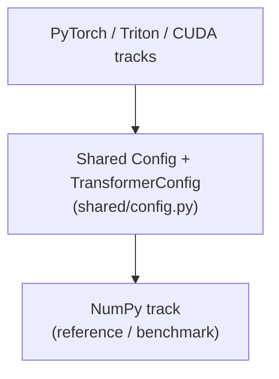

# Design Document: Decoder-Only Transformer Learning Project

**Date:** 2026-06-26 (last synced: 2026-10-11)
**Goal:** Build a fully functional decoder-only transformer LLM in 4 equivalent implementations (NumPy, PyTorch, Triton, CUDA) for educational purposes — covering the modern production surface: RoPE, GQA, SwiGLU, opt-in MoE (with shared experts), exact KV cache, TurboQuant, and speculative decoding (MTP + DSpark drafters).

This document owns the **design doctrine and the irreversible decisions**.
The directory tree lives in [README.md](../../README.md) → "Project
structure"; the term definitions in [CONTEXT.md](../../CONTEXT.md); the math
in [docs/math/](../math/). The status of any work item lives in git history
and the test suites — not in prose tables here.

## Track intent (doctrine)

Each track is written to teach a different skill — this guides every docstring
and comment choice:

- **NumPy = how the math works.** Every operator is hand-derived with formula
  citations and shape comments; the analytic backward is the lesson.
- **PyTorch = how to do it properly with a framework.** Production idiom:
  `nn.Module` composition, autograd, SDPA, `torch.optim`. Read it to learn
  how this model should be written in real code.
- **Triton = how to write the kernels.** Memory-traffic-aware kernels
  (online softmax) over the PyTorch skeleton.
- **CUDA = the bare metal.** NVRTC kernels, explicit launches, no framework.

When a track deviates from its simplest correct form, the deviation must
answer that track's question (e.g. Triton fuses because kernel fusion *is*
the lesson); pedagogical shortcuts that would mislead about production
practice get a `# PROD:` note instead.

## Cross-track naming (audited 2026-09, revised 2026-09-23)

Deliberate: every track owns `forward` + `load_from_numpy_dict` +
`get_all_parameters`/`save_as_numpy` and `make_cache` / `forward_prefill` /
`forward_step` (the shared KV-step interface), and classes carry the
track prefix (`NumPyModel`, `TorchModel`, `TritonModel`, `CUDAModel`).
Known deltas, kept consciously:

- The NumPy `TextGenerator` skips the `NumPy…` prefix —
  that track is the reference, so its names are the unadorned canonical
  ones. The torch/triton/cuda generators are thin aliases over
  `shared/generator.py`'s generator (the single deep implementation), not
  parallel teaching artifacts — they've collapsed, not diverged.
- Every track publicizes the KV-step interface (`make_cache` /
  `forward_prefill` / `forward_step`) plus `forward_chunk` — k tokens'
  K/V appended in ONE pass, the speculative-decoding verification path
  (ADR 0003).
- `forward_state` (public, no underscore) is the capture-carrying forward on
  every operator/block/stack/model — it is a cross-module seam consumed by
  the learning-mode record adapters, so it is not private.

## Architecture

### Weight Flow

- All 4 backends accept the same JSON config + env vars → same model topology
- **Save**: NumPy `get_all_parameters()` / PyTorch `save_as_numpy()` / Triton `save_as_numpy()` / CUDA flat → `model.npz` (flat dict, via the shared `ParameterRegistry`)
- **Load**: NumPy `load_from_*` / PyTorch `load_from_*` / Triton `load_from_*` / CUDA flat assign
- **PyTorch↔Triton**: direct load via compatible `save_as_numpy()` / `load_from_numpy_dict()`
- **NumPy↔NumPy**: direct load (identical API)
- **NumPy↔CUDA**: direct load via shared flat format (no conversion needed)

## Training & Inference

### Training

- **Loss function**: Cross-entropy (label smoothing = 0.0)
- **Optimizer**: AdamW (β1=0.9, β2=0.999, eps=1e-8), fixed learning rate
  (no scheduler — learning-rate scheduling is deliberately out of scope)
- **Gradient clipping**: Norm clipping (max_norm=1.0)
- **Batch size**: Context-length chunks for next-token prediction (e.g., 32×256)
- **Data pipeline**: Tokenizer → TokenizedDataset → DataLoader → forward → loss → step

### Inference

- **Greedy decoding**: `argmax(logits)` → deterministic, best for testing
- **Weighted sampling**: Sample from softmax(logits / temperature) → stochastic
- **KV Cache**: Full caching of past key/value tokens; the per-token step
  path (`forward_prefill` + `forward_step`) is exact, one token per
  iteration. TurboQuant (1-bit quantized cache) is a documented,
  parity-budgeted alternative behind `forward_step(quantize=True)`.
- **Speculative decoding** (ADR 0003): a distilled drafter proposes a k-token
  block; the target verifies it in one `forward_chunk` pass; the longest
  agreeing prefix commits (greedy: token-identical to plain decoding — the
  lossless contract; NumPy also implements the rejection-sampling theorem
  for temperature mode). Drafters: MTP (sequential, k=4) and DSpark
  (semi-AR parallel + causal refine, k=8, confidence-scheduled verification
  at a 0.8 survival target), sidecar checkpoints, both sharing the target's
  embedding + lm_head. See
  [ADR-0003](adr/0003-speculative-decoding-drafters.md).

## Platform Target

| Component | Value |
| ----------- | ------- |
| **Device** | NVIDIA Jetson AGX Orin 64GB |
| **OS** | JetPack 7.2.1 |
| **CUDA** | CUDA 13.2 |
| **PyTorch** | PyTorch 2.13.0+cu132 (pinned `pytorch-cu132` uv index) |
| **GPU** | 2048 CUDA cores, 64-bit memory, ~20 TFLOPS |

## Key Design Decisions

1. **4 backends, same topology** — All accept JSON config, produce same model structure
2. **NumPy as truth benchmark** — Pure Python/numpy implementation used as the reference for all other backends
3. **Independent training** — Each backend trains independently with its own random seed, but should produce equivalent weights
4. **Round-trip tests** — Save to NumPy format, load into any backend, verify inference matches
5. **Flat checkpoint format** — All backends save/load `model.npz` as a flat dict (keys from the shared `Keys` scheme), enabling cross-backend transfer
6. **Standard additive residual** — the block uses the plain pre-norm skip `out = x + f(ln(x))`, matching LLaMA and every modern reference (the repo-specific "gated residual" was abandoned — see [ADR-0001](adr/0001-gated-residual-abandonment.md))
7. **Config-bounded KV cache** — the cache is the model's dict cache
   (`make_cache` / `forward_prefill` / `forward_step`) with TurboQuant 1-bit
   quantization as the documented alternative; LRU/LFU multi-level caching
   was explicitly rejected as out of scope
8. **PyTorch nn.Module wrapper** — PyTorch/Triton models are `nn.Module` instances (training via `.parameters()`); `CUDAModel` is a plain class whose tensor attributes carry `requires_grad`
9. **Drafter sidecars, not registry keys** — draft weights live outside the
   target's `model.npz` (ADR 0003): the checkpoint format and every
   existing checkpoint stay untouched; drafters load per request and the
   same sidecar runs on all four tracks

The irreversible decisions (residual form, shared-expert MoE, drafter
sidecars) are recorded as ADRs in [adr/](adr/) — this section summarizes;
the ADR is the record.
